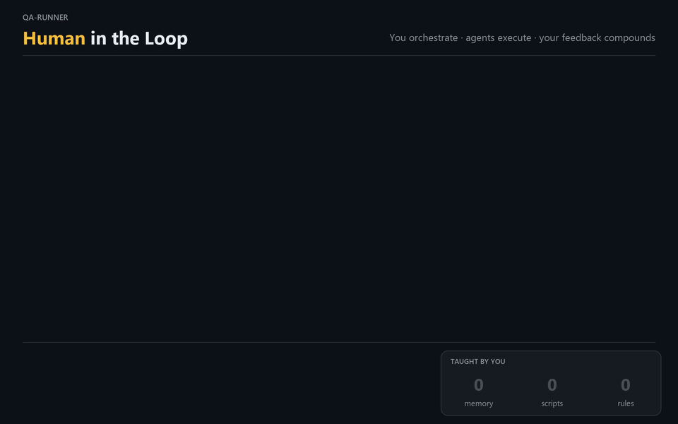

# qa-runner

[](https://skills.sh/he1ox/AgenticTestRunner)
[](https://github.com/he1ox/AgenticTestRunner/actions/workflows/ci.yml)

Agent skills that run manual-style end-to-end test plans with browser agents, show the results
in a local viewer, and rerun only the cases a human rejects. They work in any coding agent that
runs shell commands: Claude Code, Codex, Cursor, Gemini CLI, OpenCode, GitHub Copilot CLI and
others.



You stay in the loop where judgment matters: you approve the cases, answer the agents when they
are missing a value, accept or reject each result, and decide which lessons they keep. Everything
you approve is reused by later runs, so you step in less each time and the agents work more the
way you do.

```bash
npx skills add he1ox/AgenticTestRunner
```

```
plan.json ──init──▶ brief.md per case ──Test Agent (browser)──▶ result.json + evidence/
   ▲                                                                   │
   └──── retest ◀── review.json ◀── viewer (human review) ◀── validate
```

- **Plans as data.** Test cases, steps, variants and guardrails live in a JSON plan.
- **Any agent.** The orchestration is a zero-dependency Node CLI; your agent only launches what
  it prints. Test Agents start as your agent's own subagents, or run inline when it has none.
- **Small Test Agents.** Their prompt holds only the testing rules, and every case's brief is
  about 1.5 KB.
- **Right-sized.** `init` splits the plan into batches and gives each a tier and effort. In
  Claude Code short read-only cases go to Haiku, cases that change data or need judgment to
  Sonnet, and any failure Haiku reports is re-run on Sonnet before you see it. With the Claude
  Code plugin, up to three batches run at once, each in its own isolated browser, with one
  account each when your app allows only one session per user.
- **Contract checks.** `validate` flags missing evidence, unexplained failures, missing
  recordings and leaked credentials before anyone trusts a verdict.
- **Dashboard.** The viewer opens on how your agents are doing: pass rate, failures, blocked
  cases, average agent time per case (excluding time waiting on you), reviewer agreement and
  questions asked, plus cost per run (API list-price equivalent, exact from agent
  transcripts; "n/a" when the harness reports no usage or the model has no price), with outcomes by run and by variant, cases that need attention, the slowest
  cases, and your recent runs. Filter by date range and plan.
- **Local viewer.** Live progress, screenshots with non-destructive marks (arrows, boxes,
  spotlight, blur), recordings, a per-case agent chat, and Approve / Needs retest / Reject.
- **Reference comparison.** Optionally compare each case against another app (legacy,
  production, a design) and report deviations.
- **Test library and Test plans.** Every case an agent passes is saved as a script, read from
  the browser server's own call log (or the agent's transcript in Claude Code) at no extra cost,
  with any agent: same steps, same annotated screenshots, same recording. In the viewer you group scripts into Test plans ("Release 1.0.1", tags `smoke`,
  `regression`…) and run them deterministically: no agent, no tokens. When a replay fails because
  the UI changed on purpose, "Repair with agent" re-records just that case.
- **Memory.** When an agent needs a value it does not have, it asks you in the viewer and waits.
  Tick "Remember" and later runs in the same situation reuse the answer. Agents also propose
  what they learned; nothing is reused until you approve it. Secrets are stored only as
  `env:NAME` references.


Every verdict comes with proof. With recording on, the agent records the tab while it tests, and
the video is saved as an MP4 with the dead air cut. For each expected result it takes a screenshot
and marks it: boxes, arrows, numbered steps, text legends, blur for personal data, spotlight. The
marks live in a JSON file next to the image, never in its pixels, so you can add your own in the
viewer, switch them off, or export a flattened PNG, and a replay redraws the same marks.

## Skills

| Skill | Use it to |
|---|---|
| [`qa-setup`](skills/qa-setup/SKILL.md) | Prepare a project once: check Node/npx/ffmpeg, register the browser, write `.qa/config.json` |
| [`write-test-plan`](skills/write-test-plan/SKILL.md) | Turn a ticket into `.qa/plans/<KEY>.plan.json` and get the case list approved |
| [`run-test-plan`](skills/run-test-plan/SKILL.md) | Run the plan with browser agents, open the viewer, retest what a reviewer rejects |
| [`replay-test-plan`](skills/replay-test-plan/SKILL.md) | Replay saved Test plans without an agent, repair stale scripts |

Install all four: the last three call the CLI that lives in `run-test-plan`.

## Requirements

- An agent that runs shell commands and MCP tools
- Node.js 20+ (no npm dependencies); installing with `npx skills add` needs Node.js 22.20+ for the installer itself
- `npx` on the PATH: the browser is [Playwright MCP](https://github.com/microsoft/playwright-mcp)
  (pinned version, isolated profile)
- `ffmpeg` on the PATH, only for recordings

## Install

**Any agent, with the [skills CLI](https://github.com/vercel-labs/skills):**

```bash
npx skills add he1ox/AgenticTestRunner
```

It detects your agents and installs the four skills for each (`-a codex -a cursor` to choose,
`-g` for every project, `--list` to see them first). Then register the browser once: ask your
agent to "set up qa-runner" (the `qa-setup` skill), or run
`node <skills folder>/run-test-plan/scripts/qa-runs.mjs doctor --harness <your agent>`, which
prints the exact command for your agent.

**Or as a plugin, which also registers the browser for you.** Pick one install per agent, plugin
or `npx skills`, not both, or every skill shows up twice.

| Agent | Install |
|---|---|
| Claude Code | `claude plugin marketplace add he1ox/AgenticTestRunner`, then `claude plugin install qa-runner@AgenticTestRunner` (adds the 3-browser pool and dedicated Test Agents) |
| Codex | `codex plugin marketplace add he1ox/AgenticTestRunner`, then install `qa-runner` from `/plugins` |
| GitHub Copilot CLI | `copilot plugin install he1ox/AgenticTestRunner` |
| Cursor | install from the repository URL as an Agent Plugin (`plugin.json` + `mcp.json` at the root) |
| Gemini CLI | `gemini extensions install https://github.com/he1ox/AgenticTestRunner` |
| VS Code | **Chat: Install Plugin From Source** with the repository URL |
| OpenCode, others | `npx skills add`, then register the browser as above |

What works where:

| | Claude Code plugin | Any other install |
|---|---|---|
| Plans, runs, viewer, review, retest, memory, questions | yes | yes |
| Parallel batches (3 isolated browsers) | yes | one at a time |
| Model per tier (Haiku, escalation to Sonnet) | yes | session model, or `execution.tiers` |
| Script library (passing cases saved as replayable scripts) | yes | yes, from the browser server's call log |
| Cost per run | exact, from transcripts | from reported tokens priced by `config.pricing`, else "n/a" |
| Viewer chat | `claude -p` | the harness's headless CLI (`codex exec`, `gemini -p`, `opencode run`, `copilot -p`); none for Cursor |

Per-agent details: [`references/harness/`](skills/run-test-plan/references/harness/).

### Claude Code plugin, step by step

This fork ([he1ox/AgenticTestRunner](https://github.com/he1ox/AgenticTestRunner)) is its own
plugin marketplace, named `AgenticTestRunner`; the plugin is `qa-runner`. If you installed the
upstream plugin from the `jorgeebits/qa-runner` marketplace, uninstall it first with
`claude plugin uninstall qa-runner@qa-runner`: both register the same agents and browser tools.

```bash
claude plugin marketplace add he1ox/AgenticTestRunner
```

```bash
claude plugin install qa-runner@AgenticTestRunner
```

Restart Claude Code so the skills load. `claude plugin list` should show
`qa-runner@AgenticTestRunner` enabled, and `claude mcp list` the servers `qa-browser-1..3` once a
session has started. Call a skill directly with `/qa-runner:run-test-plan`. To update:
`claude plugin marketplace update AgenticTestRunner`, then
`claude plugin update qa-runner@AgenticTestRunner`.

Optional, for recordings: install `ffmpeg` (`winget install Gyan.FFmpeg`, `brew install ffmpeg`
or `sudo apt install ffmpeg`).

## Set up a project

Ask your agent to "set up qa-runner" (the `qa-setup` skill), or create `.qa/config.json` in the
project you test yourself (every field is optional; see
`skills/run-test-plan/schemas/config.schema.json`):

```json
{
  "harness": "codex",
  "tracker": { "name": "GitHub", "issueUrl": "https://github.com/org/repo/issues/{key}" },
  "targets": { "app": "New checkout", "reference": "Legacy checkout" },
  "variants": { "device": { "label": "Device", "values": ["desktop", "mobile"] } },
  "capabilities": { "login": "my-app-login" },
  "execution": {
    "sessions": "exclusive",
    "accounts": [
      { "user": "qa-user-01", "secret": "env:QA_PASS_1" },
      { "user": "qa-user-02", "secret": "env:QA_PASS_2" }
    ]
  }
}
```

`execution` controls speed and cost. With `sessions: "exclusive"` (the default, for apps where a
new login ends the user's other sessions) each batch running at the same time needs its own
account, so two accounts mean two browsers at once; with only the plan's login, batches run one
at a time. Use `"shared"` when one user may be logged in from several browsers. `tiers`,
`maxCasesPerAgent`, `maxParallel` and `escalate` tune the routing; see
`skills/run-test-plan/schemas/config.schema.json`. Passwords stay in environment variables.

Add `.qa/runs/` to `.gitignore`; commit `.qa/memory/` to share what agents learned with your
team, and `.qa/tests/` and `.qa/suites/` (the test library and Test plans). `examples/` holds a complete config, plan and memory.

## Use

Ask your agent to run a test plan ("run the test plan for SHOP-42", "corre los test cases"). The
skills draft or reuse `.qa/plans/<KEY>.plan.json`, ask you to approve the cases, run them, and
open the viewer at `http://127.0.0.1:4321`.

The CLI also works on its own:

```bash
node skills/run-test-plan/scripts/qa-runs.mjs doctor --harness codex
node skills/run-test-plan/scripts/qa-runs.mjs init .qa/plans/SHOP-42.plan.json --label smoke --harness codex
node skills/run-test-plan/scripts/qa-runs.mjs open
node skills/run-test-plan/scripts/qa-runs.mjs next <runId>
node skills/run-test-plan/scripts/qa-runs.mjs validate <runId>
node skills/run-test-plan/scripts/qa-runs.mjs profile ~/.claude/projects/<project>/*/subagents/*.jsonl
node skills/run-test-plan/scripts/qa-runs.mjs memory --help
```

| Variable | Default | Purpose |
|---|---|---|
| `QA_PROJECT_DIR` | current directory | Project whose `.qa/` folder is used |
| `QA_HARNESS` | detected, else `generic` | Agent harness, when `.qa/config.json` and `--harness` don't say |
| `QA_RUNS_DIR` | `.qa/runs` | Where runs are written |
| `QA_VIEWER_PORT` | `4321` | Viewer port |
| `QA_CHAT_HARNESS` | project's harness | CLI behind the viewer's agent chat: `claude`, `codex`, `gemini`, `opencode`, `copilot` |
| `QA_CHAT_BIN` | that CLI | Binary the chat runs (`QA_CLAUDE_BIN` is the old name, for `claude`) |
| `QA_CHAT_MODEL` | `sonnet` (Claude), else the CLI's default | Model behind the viewer's agent chat |
| `QA_CHAT_EFFORT` | `low` | Effort for the viewer's agent chat |
| `QA_PLAYWRIGHT_MCP` | `@playwright/mcp@0.0.82` | Playwright MCP package the browser pool runs |
| `QA_BROWSER_ARGS` | none | Extra Playwright MCP flags for every browser, e.g. `--headless` |
| `QA_USER_MEMORY_DIR` | `~/.qa/memory` | Personal memory folder |
| `QA_PASSWORD` | none | Password deterministic replays type when the account has no `secret` |
| `QA_REPLAY_DEBUG` | off | Print every action a deterministic replay sends and the browser's reply |

### Test plans: deterministic runs

Once agents have passed some cases, open the viewer's **Tests** view to see the library (tags,
draft or verified, last replay) and **Test plans** to create one: name it, add your tags, pick
tests (or every test with a tag) and press **Run**. The run replays each script in its own
headless browser and shows up like any other run, marked Deterministic, at $0. The same from the
terminal:

```bash
node skills/run-test-plan/scripts/qa-runs.mjs tests --tag smoke
node skills/run-test-plan/scripts/qa-runs.mjs suite create "Release 1.0.1" --tags smoke,regression --tag smoke
node skills/run-test-plan/scripts/qa-runs.mjs suite run release-1.0.1
```

Scripts type the login password from the account's `env:NAME` secret or `QA_PASSWORD`, so start
the viewer from a shell that has them. See the
[`replay-test-plan`](skills/replay-test-plan/SKILL.md) skill.

`profile` shows where agents' tokens went (context size per turn, tool results by tool), from any
transcripts, so you can measure a change against earlier runs.

## Develop

See [AGENTS.md](AGENTS.md). In short: the Test Agents' rules live in
`skills/run-test-plan/scripts/agents.mjs` and the metadata in `.claude-plugin/plugin.json`;
`node scripts/build.mjs` regenerates every agent file and manifest from them, and
`node scripts/validate-skills.mjs` checks the skills against the
[Agent Skills spec](https://agentskills.io/specification). CI runs both. Changes are listed in
[CHANGELOG.md](CHANGELOG.md).

## Roadmap

See [ROADMAP.md](ROADMAP.md).

## License

[MIT](LICENSE)
